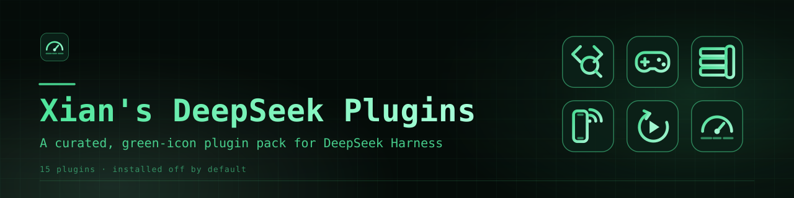

<p align="center">
  
</p>

<h1 align="center">Xian's DeepSeek Plugins</h1>

<p align="center">
  Fifteen plugins I use every day with DeepSeek Harness — one market index, one install script, all off by default.
</p>

<p align="center">
  <a href="LICENSE"></a>
  
  
</p>

---

## Why this pack

This is not a link dump. It is the exact set of plugins that stay installed on my
machine after the novelty wears off — the ones that change how a Harness session
actually runs:

- **One index, one command.** The repo ships a DSH plugin-market index and an
  install script, and both install the same 15 packages into a profile.
- **Off by default.** All 15 rows in `cordis.patch.yml` carry `disabled: true`,
  and the script and manual paths install exactly those rows, so nothing starts
  until you toggle a plugin on.
- **Pinned and reproducible.** The 11 in-house packages are vendored at their
  exact versions; the 4 published packages are pinned to exact npm versions.
- **One icon language.** All 15 icons follow the same green Hadal Mint drawing
  rules, so the Plugin Manager reads as one pack instead of fifteen vendors.

New here? Read [docs/INSTALL.md](docs/INSTALL.md) for the three install paths and
the restart rules, and [docs/PLUGINS.md](docs/PLUGINS.md) for one detailed card
per plugin.

## What's inside

| Icon | Plugin | Category | What it does | Install |
|---|---|---|---|---|
|  | **context-lens** | Context | Semantic AST code skeletons and compressed build/test logs. | npm |
|  | **notify** | Reliability | Sounds, toasts, desktop and web push, IM webhooks on task_done / error / approval. | npm |
|  | **git-worktree** | Git | Branch picker, commit graph, and isolated git worktrees in the Web UI. | npm |
|  | **repo-map** | Context | Read-only repository structure and symbol map. | npm |
|  | **agent-team-plus** | Agent teams | Role-based teammates with tool/write budgets and structured handoffs. | in-repo |
|  | **browser-control** | Verification | Headless Chromium control of the live Web UI for real UI checks. | in-repo |
|  | **game-lab** | Android | In-app Android emulator: live screen, touch input, install-and-play. | in-repo |
|  | **harness-chrome** | Web UI | Lamprey-style File/Edit/View/Window/Help header menu tabs. | in-repo |
|  | **harness-deck** | Web UI | Lamprey-style right workspace deck with six guide cards. | in-repo |
|  | **harness-rail** | Web UI | Lamprey-style left rail pages and a bottom status strip. | in-repo |
|  | **inhouse-browser** | Web UI | Tabbed in-app web browser with bookmarks and local history. | in-repo |
|  | **mobile-host** | Mobile | Loopback HTTP API v1 for the DSH Mobile Android app. | in-repo |
|  | **run-hidden** | Workflow | Runs windowed programs on an invisible Windows desktop. | in-repo |
|  | **session-resume** | Reliability | Resumes turns interrupted by a host crash or restart. | in-repo |
|  | **system-monitor** | Web UI | Live CPU and memory readout in the sidebar footer. | in-repo |

**npm** — published package pulled from the npm registry at a pinned version.
**in-repo** — vendored under [`plugins/`](plugins) in this repository, so the
market index serves the exact code you see here. Versions and upstream links are
in [docs/PLUGINS.md](docs/PLUGINS.md).

## Install

All three paths install the same 15 plugins. Pick one; the result is the same
package set, and the script and manual paths leave every plugin off until you
enable it.

### A — from the market index

1. Open **Settings → Plugins → Discover** in the Harness Web UI.
2. Add this index URL:

   ```text
   https://raw.githubusercontent.com/LordGrimTaken/Xians-DeepSeek-Plugins/main/index.json
   ```

3. Install the entries you want from the list.

### B — one-shot script

Clones the repo and installs every plugin plus the 15 off-by-default loader rows:

```bash
git clone https://github.com/LordGrimTaken/Xians-DeepSeek-Plugins.git
cd Xians-DeepSeek-Plugins
./scripts/install.sh --profile web
```

`--profile` defaults to `web`. Run `./scripts/install.sh --list` to see the 15
slugs, add `--only notify,system-monitor` to install a subset, and `--dry-run` to
print the commands without running them.

### C — manual, one plugin at a time

```bash
# Published on npm
dsh plugin --profile web add @goodandready/dsh-context-lens

# Vendored in this repo: link the absolute path to plugins/<slug>
dsh plugin --profile web add link:/path/to/Xians-DeepSeek-Plugins/plugins/agent-team-plus
```

Then copy the matching `xdp-<slug>` rows from the repo's
[`cordis.patch.yml`](cordis.patch.yml) into
`~/.dsh/profiles/web/cordis.patch.yml`.

### Turn them on

1. Open **Settings → Plugins** and toggle the row you want on.
2. Reload the page so the client half loads.
3. Restart the host for host-side plugins: `mobile-host`, `session-resume`,
   `system-monitor`, `browser-control`, `agent-team-plus`, `run-hidden`, and
   `game-lab`.

> [!IMPORTANT]
> **Everything installs off.** All 15 rows in this repo's
> [`cordis.patch.yml`](cordis.patch.yml) — the file the script installs — carry
> `disabled: true`, so the pack cannot change a running session until you enable
> a plugin in **Settings → Plugins**. Market-index entries install as normal
> bundles; toggle off anything you don't want after installing.

## The green icon set

The icons are drawn on one template, from the in-house **Hadal Mint** palette:
an abyssal-ink rounded square, a mint glyph, and a mint → ice gradient. They are
15 plain SVGs — no fonts, no external references — and stay legible at 24 px.

| Token | Value | Used for |
|---|---|---|
| Ink | `#0a1f17` | Rounded-square container |
| Mint | `#4ee59b` | Glyph stroke, container outline (55% opacity) |
| Mint light | `#a8ffd9` | End of the glyph gradient |

Drawing rules: 64×64 viewBox, one rounded-square container, glyph strokes
3.2–3.8 px with round caps and joins, no text, no external references, file
size at most 4 KB. The full token sheet and usage rules live in
[brand/palette.md](brand/palette.md); preview every icon at 40 px and 88 px in
[brand/preview.html](brand/preview.html), or see the whole family on one page in
[brand/icon-sheet.svg](brand/icon-sheet.svg).

## Repository layout

```text
.
├── README.md
├── CONTRIBUTING.md
├── LICENSE
├── index.json                 plugin-market index (format 1, 15 entries)
├── cordis.patch.yml           the 15 loader rows, all disabled: true
├── icons/                     15 SVGs, one per plugin: icons/<slug>.svg
├── brand/
│   ├── banner.svg             hero banner
│   ├── icon-sheet.svg         5x3 contact sheet of the icon family
│   ├── preview.html           self-contained icon preview page
│   └── palette.md             Hadal Mint tokens and usage rules
├── plugins/                   11 vendored plugin packages
├── scripts/
│   ├── install.sh             one-shot installer (--profile, --only, --dry-run, --list)
│   ├── pin-index.mjs          rewrites git sources to the current plugins commit
│   ├── validate.mjs           dependency-free repo validation
│   └── apply-icon-overlay.sh  optional icon overlay for npm-installed plugins
└── docs/
    ├── PLUGINS.md             one card per plugin: source, requirements, config
    ├── INSTALL.md             install, enable, update, uninstall, troubleshooting
    ├── INVENTORY.md           the full installed inventory, including exclusions
    └── CREDITS.md             authors, upstream repos, licenses
```

## Requirements

- **DeepSeek Harness 0.2.x** — check with `dsh --version`.
- **Node.js 22+** — `git-worktree` declares `>=22.19`, `mobile-host` `>=22`.
- **pnpm** — `dsh plugin ... add` forwards to pnpm in the profile directory.
- **git** — for cloning the repo and for `git-worktree`.

Per-plugin extras: a Chromium-based browser for `browser-control`, the Android
SDK with an x86_64 system image for `game-lab` (plus a JDK and Node/npm for
Build & play), Windows with PowerShell for `run-hidden`, and the DSH Mobile
Android app for `mobile-host`. Details are in
[docs/INSTALL.md](docs/INSTALL.md#prerequisites).

## Documentation

| Document | What's in it |
|---|---|
| [docs/PLUGINS.md](docs/PLUGINS.md) | One card per plugin: tagline, what it does, why you'd want it, package/version/source, requirements, verified config, upstream link. |
| [docs/INSTALL.md](docs/INSTALL.md) | Prerequisites, three install methods, enable/disable, update, uninstall, troubleshooting, verification checklist. |
| [docs/INVENTORY.md](docs/INVENTORY.md) | Every non-core plugin on the maintainer's machine: the 15 included and the 3 excluded, with reasons. |
| [docs/CREDITS.md](docs/CREDITS.md) | Maintainer, npm authors and their upstream repos, vendored packages, MIT attribution, icon design. |
| [CONTRIBUTING.md](CONTRIBUTING.md) | Scope, how to add a plugin, icon rules, validation, commit style. |

## Credits

Maintained by [Xian (LordGrimTaken)](https://github.com/LordGrimTaken). The npm
plugins are MIT-licensed work by GooDAnDReaDY, LaoYueHanNi, and MkaliezZ;
`game-lab` and `mobile-host` are mirrors of Xian's public repos. The full
attribution is in [docs/CREDITS.md](docs/CREDITS.md).

## License

[MIT](LICENSE) © 2026 Xian (LordGrimTaken).
